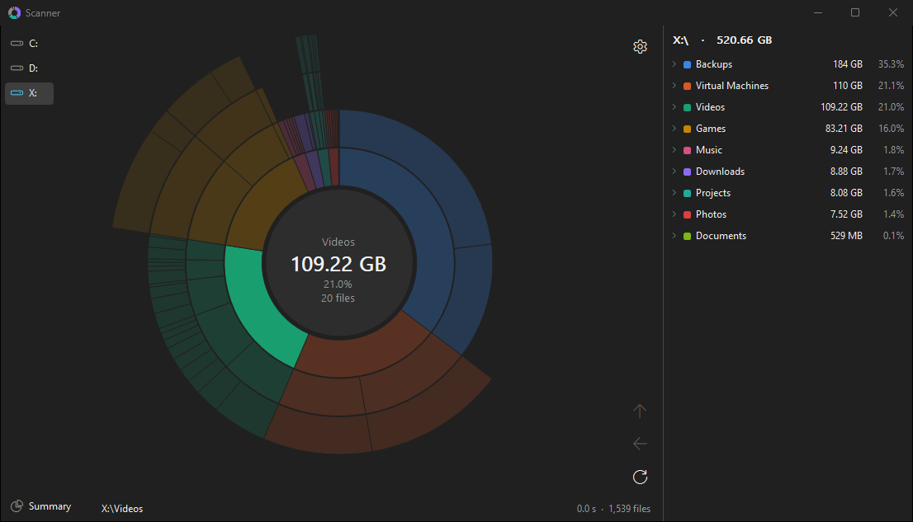

# Scanner

Shows what takes up space on a drive as a sunburst chart: the current folder sits in the centre,
and every ring around it is the next level down.



The program is a single exe of about 400 KB built on plain Win32 and GDI+: nothing to install,
no .NET and no VC++ Redistributable needed.

## Features

- A button for every ready drive on the left; **Summary** puts all drives on one chart.
- Click a segment to open the folder, click the centre to go a level up; **Back** returns to the previous view.
- Free space and "not scanned" (used, but not readable) are shown as separate segments.
- Folder panel on the right: the items of the current view with sizes and shares, expandable like a tree.
- Context menu: open, rescan the folder, open in Explorer, move to the Recycle Bin.
- Depth: 4 rings or every level; order: by name (folders first) or by size.
- Theme: system (with the Windows accent colour), light or dark.
- Languages: English, German, Russian. The texts live in the `lang` folder next to the exe — edit them,
  or add a language by copying one of the files.
- Per-Monitor DPI v2 and long paths (over 260 characters) are supported.

A folder given on the command line opens right away: `scanner.exe D:\Projects`.

Settings are stored in the registry under `HKEY_CURRENT_USER\Software\Scanner`.

## Building

Requires Rust 1.85+ (edition 2024) with the MSVC toolchain. The exe icon needs `rc.exe` from the
Windows SDK; without it the program still builds, just without an icon.

```
cargo build --release
```

The result is `target\release\scanner.exe` with the `lang` folder next to it. The C runtime is linked
into the exe (`.cargo/config.toml`), so it runs on a clean Windows install.

```
cargo test
```

## Limitations

- Sizes are file lengths, not space on disk; hard links (WinSxS, for example) are counted more than once.
- Junctions and symbolic links are skipped, so nothing is counted twice and scans cannot loop.

## Acknowledgements

Inspired by **Scanner** by Steffen Gerlach, version 2.13, 2012 —
<http://www.steffengerlach.de/freeware/>.
